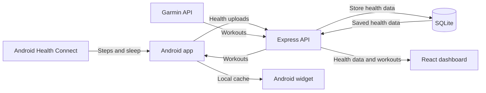

# StrideHub

StrideHub is a personal fitness dashboard and Android companion app that brings
Garmin workouts, daily steps, and sleep data into one place. The web dashboard
shows your data by date, while the Android app reads Health Connect, synchronizes
with the server, and displays a home-screen widget.

## What it does

- Displays Garmin workouts with metrics such as distance, duration, pace, heart rate, and calories when available.
- Shows daily step counts, individual sleep sessions, and total sleep duration.
- Lets you browse fitness data by date in the web dashboard and Android app.
- Uploads health data from Android to your own server.
- Keeps downloaded workouts and health data available offline on Android.
- Provides background synchronization and a widget for today's data.
- Protects the web dashboard with password login and Android requests with a device token.

## How it works

### Steps and sleep

After you grant Health Connect permissions, the Android app reads steps and sleep
records available on the phone. It saves daily results locally and marks changed
data as pending for upload.

The app sends pending days to the backend through `POST /api/health/sync`. The
server validates the payload and saves it in a SQLite transaction. Step totals
are updated by date, and sleep sessions are updated by their IDs, so uploading
the same records again updates them instead of creating duplicates. Android marks
a day as synchronized only after the server confirms the upload.

The dashboard requests `GET /api/health/daily?date=YYYY-MM-DD` to retrieve the saved
step count, sleep sessions, and their combined duration. Missing data is shown
separately from a genuine zero step count. Records deleted from Health Connect
are not automatically removed from the server.

### Garmin workouts

The backend uses its Garmin API key to obtain an access token and request workout
data. It temporarily caches the token and refreshes it if Garmin rejects it.
The Garmin API key stays on the server; neither the browser nor the Android app
needs it.

The web dashboard requests activities for the selected date. Android uses a daily
endpoint that returns normalized workout details and the backend's calendar
timezone. The server fetches Garmin activities on demand; SQLite stores uploaded
health data, sessions, and login limits rather than a permanent workout archive.

Android keeps up to 31 days of downloaded Garmin results in its local cache.
Failed downloads preserve previously saved workouts, while a successful empty
response means there were no workouts for that day. Garmin dates use the server's
configured timezone; Health Connect dates follow the phone's timezone.

### Synchronization and offline use

Manual refresh and background work update the app's data. WorkManager schedules
local health refreshes at a 30-minute interval, subject to Android permissions,
battery management, and scheduling delays. Background Health Connect reads require
background access permission.

Local health reads can run without a network connection. A separate worker waits
for connectivity, uploads pending health data, downloads today's Garmin workouts,
and refreshes the widget. Health uploads and Garmin downloads have separate
outcomes, so a problem with one does not automatically prevent the other.

Temporary network or server failures retry with increasing delays. Authentication
failures require updated backend settings or a corrected token. Cached data stays
available while offline, and the app reports synchronization status. The widget
uses local data, so it does not need to fetch directly from Garmin.

### Web dashboard and authentication

The React dashboard calls the Express API on the same origin. After password
verification, the server creates a session stored in SQLite and sends an HTTP-only
cookie to the browser. Sessions last 12 hours; production cookies require HTTPS.
Login and logout use origin and CSRF checks, and login attempts are rate-limited.

Android authenticates separately using the configured device Bearer token. Garmin
credentials remain server-side. The browser requests health data and workouts
separately, allowing available health data to remain visible if Garmin fails.

## Technologies

| Area | Technologies and role |
| --- | --- |
| Web dashboard | React and JavaScript for the interface; CSS for styling; Vite for development and builds |
| Backend | Node.js and Express for API routes, validation, authentication, and Garmin requests |
| Database | SQLite through `better-sqlite3` for health records, browser sessions, and login limits |
| Authentication | `express-session`, scrypt password hashing, CSRF checks, and device Bearer tokens |
| Android interface | Kotlin, Jetpack Compose, and Material 3 |
| Android health data | Health Connect for reading steps and sleep |
| Android background work | WorkManager for scheduled refreshes and network retries |
| Android storage and widgets | DataStore for local cached data; Glance for the home-screen widget |
| Integration | Garmin API for workout data |
| Testing | Vitest and React Testing Library for the web; Node.js test runner for the backend; JUnit for Android |
| Build and tooling | npm, Gradle, and ESLint |

## Project structure

- `client/` — React dashboard, activity and health cards, and browser API client.
- `server/` — Express API, Garmin integration, authentication, and SQLite storage.
- `android/` — Android app, Health Connect integration, local cache, sync workers, and widget.

For Android build instructions and device checks, see the
[Android README](android/README.md) and [testing guide](android/TESTING.md).
